# Forest Cover Type Classification

[](https://github.com/mara-werils/forest-cover-classification/actions/workflows/tests.yml)

Final project for **Programming for AI** (Applied Artificial Intelligence, MSc), topic 37,
cluster 7 "Machine Learning on Tabular Data".

**Goal:** predict which of 7 forest cover types grows on a 30 × 30 m cell of the Roosevelt
National Forest (Colorado) from cartographic and soil variables only, and compare a
baseline with Logistic Regression, Random Forest and Gradient Boosting on a multi-class,
strongly imbalanced problem (F1-macro, confusion matrix).

**Team**

| Member | Group | Main responsibility |
|---|---|---|
| Amanbaev Marlen | AAI-2601M | Data loading, Parquet & dtype optimisation, SQLite schema + SQL, console menu, Streamlit app |
| Aktaev Erik | AAI-2601M | Data quality audit, EDA, visualisations, feature relevance and area-shift statistics, tests and CI |
| Gajiyev Rashad | AAI-2601M | Feature pipelines, model tuning & comparison, interpretation, error analysis |

The report and the presentation were written together; every member can explain every
module (see the report, section "Contributions").

---

## Data

* **Source:** UCI Machine Learning Repository, *Covertype* (Blackard & Dean, 1998),
  <https://archive.ics.uci.edu/dataset/31/covertype>, licence CC BY 4.0.
* 581,012 rows × 55 columns: 10 numeric features, 4 one-hot wilderness areas,
  40 one-hot soil types, target `Cover_Type` (1–7).
* The archive (11 MB zipped, 72 MB as CSV) is **downloaded automatically** by step 1 into
  `data/raw/`; it is not stored in the repository. Committed data files:
  `data/processed/covtype.parquet` (all 581,012 rows, compact dtypes, 7 MB) and a stratified
  1,000-row sample `data/sample/covtype_sample_1000.csv` used by the tests. The SQLite database
  (71 MB) is rebuilt from the Parquet file by menu option 3 in about a minute.

## Quick start

```bash
git clone https://github.com/mara-werils/forest-cover-classification.git
cd forest-cover-classification
python -m venv .venv && source .venv/bin/activate      # Windows: .venv\Scripts\activate
pip install -r requirements.txt

python main.py --all        # full pipeline, ~30–60 min on a laptop CPU
python main.py              # interactive console menu
streamlit run app.py        # dashboard with filters + prediction form
python -m pytest -q         # 157 tests, ~5 s (sample + a few checks on the full Parquet)
```

Developed and tested with Python 3.14 on macOS (Apple Silicon, 16 GB RAM); only CPU is
needed, Python 3.11–3.14 with the pinned packages in `requirements.txt`. Works the same in
VS Code / PyCharm (run `main.py`) and in Google Colab
(`!git clone ...`, `%cd forest-cover-classification`, `!pip install -r requirements.txt`,
`!python main.py --all`).
Thread count defaults to 4 and can be changed with `FCT_THREADS=8 python main.py --all`.
On macOS LightGBM needs the OpenMP runtime: `brew install libomp`.

`make help` lists shortcuts for the same commands (`make test`, `make lint`, `make app`,
`make stats`, `make docs`, `make all`).

### Console menu

```
 1 - Prepare data (download, chunked load, dtype optimisation, Parquet)
 2 - Data quality audit
 3 - Build SQLite database (normalised schema)
 4 - Exploratory analysis: save all figures
 5 - Train and compare models (baseline, LR, RF, HistGB, LightGBM)
 6 - Interpret best model (importance, error analysis, learning curve)
 7 - Run an SQL query
 8 - Predict cover type for your own values
 9 - Show experiment results
10 - Robustness: ROC/PR-AUC + unseen-area validation (~25 min)
11 - Statistics: feature relevance + shift between wilderness areas
12 - Feature ablation: do the engineered features help? (~25 min)
13 - Significance: bootstrap CIs + McNemar tests between models (~15 min)
 0 - Exit
```

The processed Parquet file and the trained model are in the repository, so options 7–9
and the Streamlit app work right after cloning (option 7 needs step 3 for the database).
To rebuild everything from the raw data, run steps 1 → 6 in order. Every step reads its input from disk,
so after one full run any step can be repeated on its own. A missing input file or an
invalid value is caught (`try/except`) and reported without leaving the menu.

## Project structure

```
forest-cover-classification/
├── main.py               console menu, `--all` for the full pipeline
├── app.py                Streamlit dashboard (filters, EDA, data quality, SQL, models, prediction)
├── requirements.txt      pinned versions (requirements-dev.txt adds ruff)
├── pyproject.toml        ruff + pytest configuration
├── Makefile              shortcuts: test, lint, app, stats, docs, all
├── .github/workflows/    CI: ruff + tests on Python 3.11-3.14
├── src/
│   ├── config.py         paths, column names, lookup tables, seeds
│   ├── data_loader.py    download, chunked typed read, memory report, Parquet, CSV vs Parquet
│   ├── audit.py          missing values, duplicates, one-hot integrity, ranges, IQR outliers
│   │                     (global and inside each cover type)
│   ├── eda.py            all EDA figures (+ interactive Plotly scatter, aspect rose, shadows)
│   ├── relevance.py      model-free feature relevance: Kruskal-Wallis, Cramér's V, mutual info
│   ├── ablation.py       feature ablation: raw vs engineered features, leave-one-group-out
│   ├── significance.py   bootstrap CIs of F1-macro, paired bootstrap, McNemar + Holm
│   ├── shift.py          covariate / label shift between wilderness areas (PSI, KS, TVD)
│   ├── data_dictionary.py  generates docs/DATA_DICTIONARY.md from config + data
│   ├── database.py       SQLite schema, loading in chunks, experiment / prediction tables
│   ├── queries.py        12 analytical SQL queries, pandas vs SQL check
│   ├── er_diagram.py     ER diagram (PNG) + Mermaid source
│   ├── features.py       feature engineering + preprocessing pipelines, split
│   ├── models.py         model zoo, CV tuning, memory / size measurement, joblib
│   ├── evaluate.py       metrics, confusion matrices, permutation importance, error analysis
│   ├── pipeline.py       steps that glue the modules together
│   ├── robustness.py     ROC/PR-AUC, leave-one-wilderness-area-out validation
│   └── predict.py        validated single-record prediction + history (JSON)
├── tests/                157 tests: audit, features, predict, database/SQL, EDA, statistics, ablation, significance,
│                         menu, dashboard (headless), data dictionary drift
├── data/sample/          1,000-row stratified sample
├── data/processed/       covtype.parquet (7 MB, versioned); covtype.db is generated
├── models/               best_model.json (best_model.joblib is generated)
├── reports/              JSON/CSV/Parquet results, sql/ query outputs, figures/
└── docs/                 report (PDF/DOCX), presentation, ER diagram source, data dictionary
```

## Database

Normalised SQLite schema (`data/processed/covtype.db`): the 44 one-hot columns are replaced
by foreign keys, soil types are linked to climatic and geologic zones decoded from their
USFS ELU code, and experiments/predictions are stored next to the data so that model errors
can be analysed with SQL.

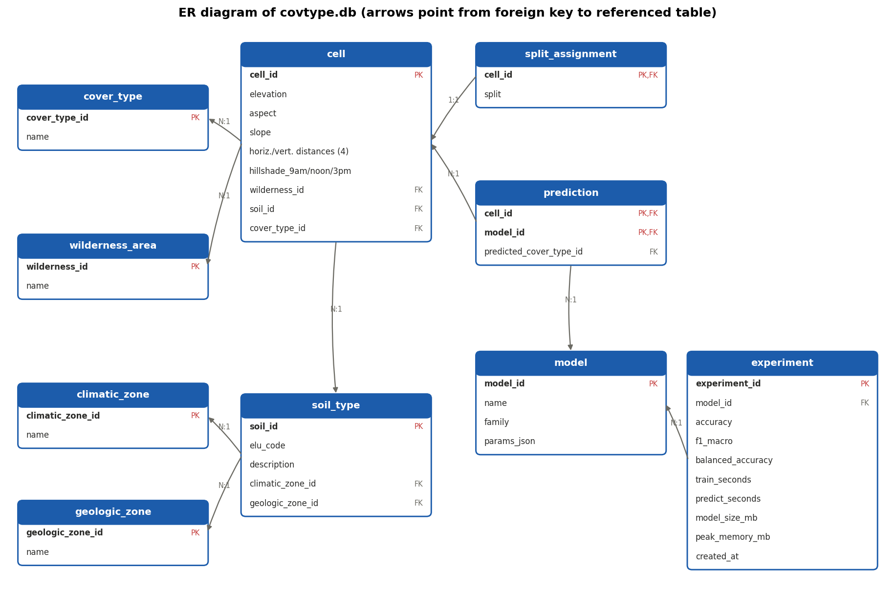

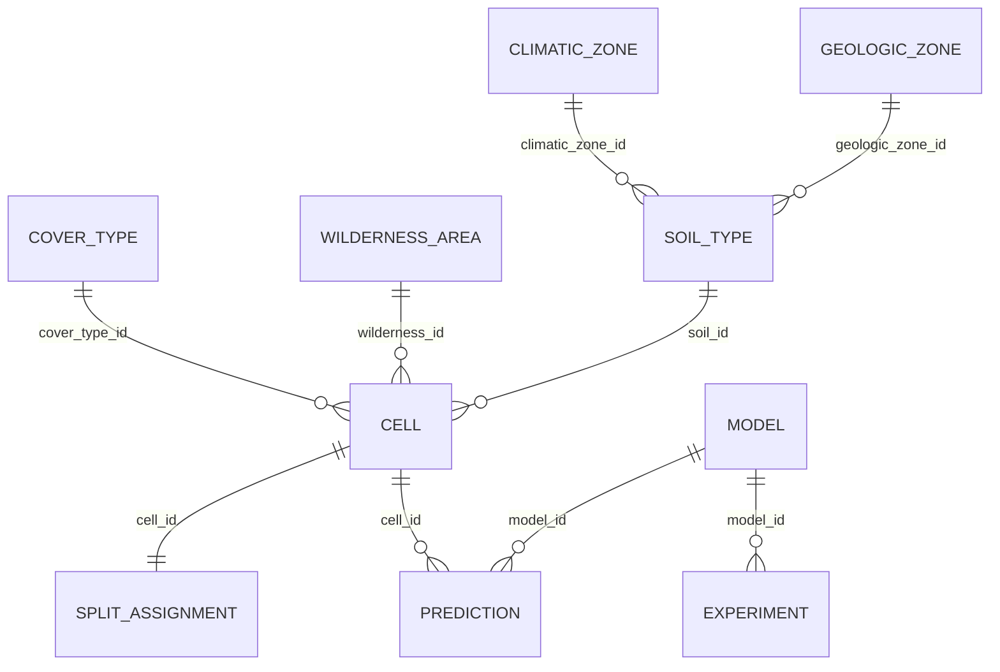

12 queries in `src/queries.py` (results in `reports/sql/`): JOINs across up to 4 tables,
GROUP BY/HAVING, correlated and FROM-subqueries, CTEs, and the window functions
`SUM() OVER`, `ROW_NUMBER`, `RANK`, `NTILE`, `LAG`. Q10–Q12 analyse model errors.

## Data processing results

| | Default `read_csv` | Chunked + compact dtypes |
|---|---|---|
| DataFrame memory | 243.8 MB (all `int64`) | **33.8 MB** (−86.1%) |

| Format | File | Load time | Peak RAM |
|---|---|---|---|
| CSV, default dtypes | 71.7 MB | 0.80 s | 488 MB |
| CSV, compact dtypes | 71.7 MB | 0.69 s | 128 MB |
| **Parquet** | **6.9 MB** | **0.15 s** | 7 MB |
| Parquet, 3 columns | 6.9 MB | 0.007 s | 1 MB |

Audit: no missing values, no duplicates, no invalid one-hot rows, no out-of-range values.
IQR outliers (≤ 5.4% per column) are real terrain extremes and were kept
(`reports/data_audit.json`). Column-by-column reference: [`docs/DATA_DICTIONARY.md`](docs/DATA_DICTIONARY.md).

## Data quality and statistics before modelling

**Outliers are mostly altitude belts.** Global Tukey fences mix seven cover types that live
at different elevations. Applied inside each class instead, 14,495 of the 15,569 elevation
outliers (93%) turn out to be ordinary cells of their own cover type (`iqr_outliers_by_class`
in the audit report), which is why clipping them would remove signal, not noise.

**`Hillshade_3pm = 0` is shadow, not missing data.** 92% of the 1,338 zero cells face east
(45–135°) on slopes ≥ 20° (median 36° vs 13° elsewhere) and continue the bright-morning tail
of the 9am/3pm density, so the values were kept instead of imputed.

| Aspect rose per cover type | Hillshade zeros |
|---|---|
| 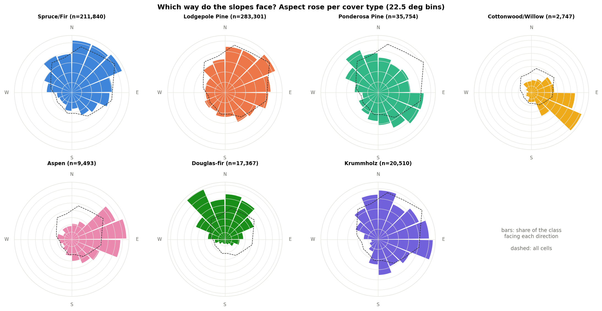 | 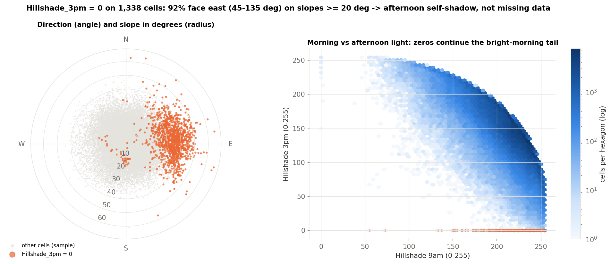 |

**Feature relevance without a model** (`src/relevance.py`, menu option 11): mutual
information with the class as a share of the class entropy (1.74 bits), plus an effect size
per feature (ε² from Kruskal–Wallis for numbers, bias-corrected Cramér's V for categories).

| Feature | Alone: MI, % of class entropy | Effect size | In the model: permutation importance rank |
|---|---|---|---|
| Elevation | 37.7% | ε² 0.51 | 1 |
| Soil | 33.5% | V 0.47 | 5 |
| Wilderness | 15.6% | V 0.44 | 4 |
| Distance to roads | 7.5% | ε² 0.12 | 2 |
| Distance to fire points | 6.0% | ε² 0.10 | 3 |
| Slope, aspect, hillshade | ≤ 3.1% | ε² ≤ 0.06 | 8–12 |

The two rankings agree overall (Spearman ρ = 0.66), with two telling exceptions: Soil is
strong alone but largely repeats elevation (soil type explains 58% of the rank variance of
elevation, ε² = 0.58, since its ELU code encodes the climatic zone), while the distances to
roads and fire points are weak alone and become the 2nd and 3rd most important inputs
through interactions.

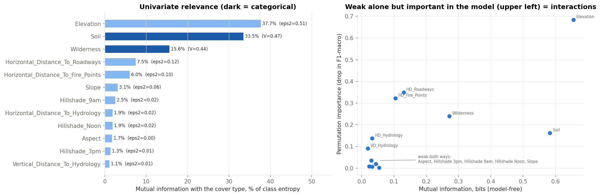

**Why an unseen area is hard** (`src/shift.py`): every area compared with the other three.

| Area | Cells | Mean PSI, numeric | Major shifts (PSI > 0.25) | Soil TVD | Label TVD | Held-out F1-macro |
|---|---|---|---|---|---|---|
| Rawah | 260,796 | 0.34 | 3 / 10 | 0.78 | 0.21 | 0.35 |
| Neota | 29,884 | 0.75 | 2 / 10 | 0.56 | 0.32 | 0.31 |
| Comanche Peak | 253,364 | 0.31 | 2 / 10 | 0.70 | 0.05 | 0.24 |
| Cache la Poudre | 36,968 | 2.01 | 9 / 10 | 0.91 | 0.88 | 0.25 |

Soil distributions are 56–91% disjoint between areas, Cache la Poudre differs on almost
every feature and is the only home of Cottonwood/Willow, and Comanche Peak scores lowest
despite almost no label shift: the relation between terrain, soil and species itself
changes from area to area, which is the data-side explanation of the group validation
result below.

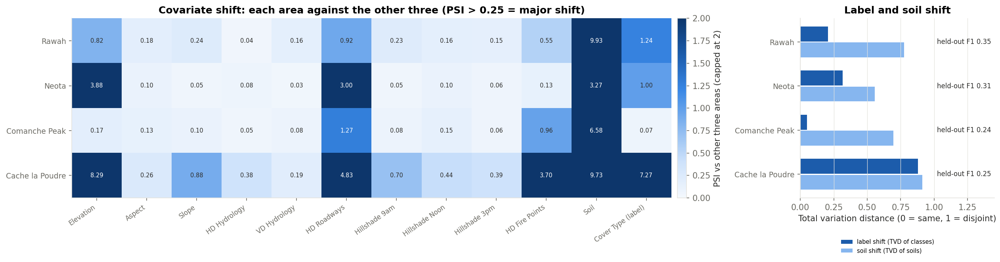

## Model results

Stratified 80/20 split (464,809 train / 116,203 test), all preprocessing inside
scikit-learn `Pipeline`s, hyper-parameters by `RandomizedSearchCV` (3-fold stratified CV,
F1-macro) on a 40k-row subsample, refit on the full train split.

| Model | Accuracy | **F1-macro** | Balanced acc. | ROC-AUC | PR-AUC | Train, s | Predict, ms / 1k rows | Size, MB |
|---|---|---|---|---|---|---|---|---|
| Baseline (most frequent) | 0.488 | 0.094 | 0.143 | 0.500 | 0.143 | 1 | 0.4 | 0.00 |
| Logistic Regression | 0.731 | 0.548 | 0.525 | 0.938 | 0.625 | 43 | 1 | 0.01 |
| Random Forest | 0.972 | 0.949 | 0.939 | 0.999 | 0.988 | 62 | 10 | 568 |
| HistGradientBoosting | 0.970 | 0.955 | 0.961 | 0.999 | 0.990 | 328 | 101 | 60 |
| **LightGBM, balanced weights** | 0.974 | **0.956** | 0.959 | 0.999 | **0.990** | 172 | 402 | 91 |
| LightGBM, no weights | 0.974 | 0.954 | 0.947 | 0.999 | 0.990 | 182 | 312 | 89 |

ROC-AUC (one-vs-rest) and PR-AUC are macro averages over the 7 classes, computed from the
predicted probabilities (`src/robustness.py`, menu option 10).

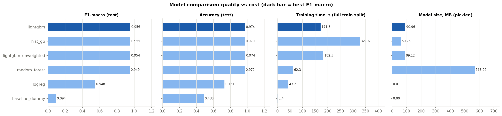

* **LightGBM with balanced class weights** is the selected model (`models/best_model.joblib`,
  40 MB compressed): best F1-macro at a moderate size.
* Tree ensembles beat the linear model by 0.41 F1-macro: the rare classes are defined by
  interactions (elevation belt × area × soil). Logistic Regression does not improve with more
  data (learning curve), Random Forest and LightGBM improve up to the full 465k rows.
* 69% of the 3,063 test errors are Spruce/Fir ↔ Lodgepole Pine, two species of the same
  elevation belt. Cells with top probability < 0.6 (1.7%) have a 45% error rate, the rest 1.9%.
* Permutation importance: Elevation ≫ distance to roads ≈ distance to fire points >
  wilderness area > soil type.
* A tuned HistGradientBoosting configuration (lr = 0.2, balanced weights) diverged when
  refitted on all data (F1-macro 0.38, see `reports/diverged_runs.json`); the search space was
  restricted to lr ≤ 0.1.

| Confusion matrix (LightGBM) | Learning curve |
|---|---|
| 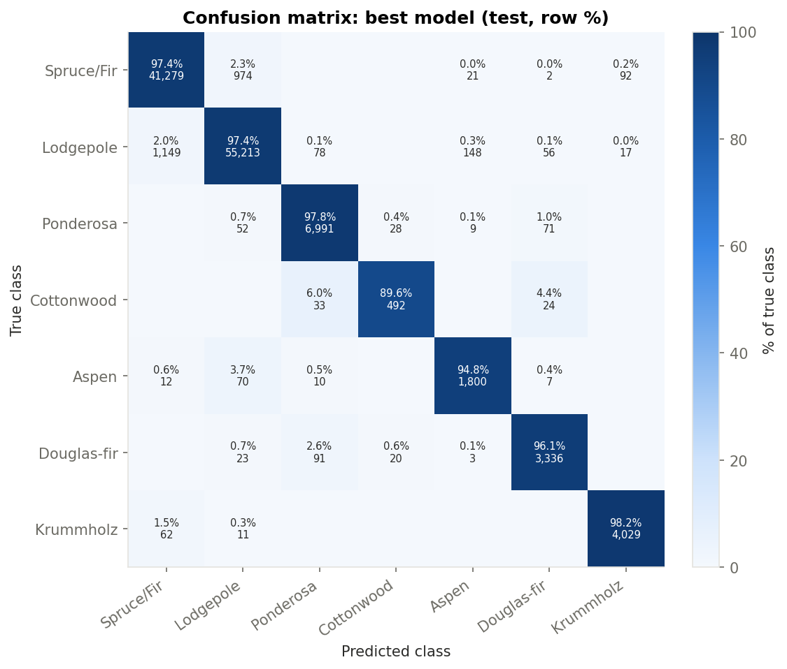 | 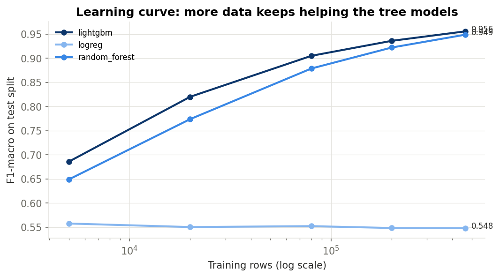 |

### Feature ablation: do the engineered features help?

`src/ablation.py` (menu option 12, `make ablation`) retrains Logistic Regression, Random
Forest and LightGBM with their tuned hyper-parameters on the same 80/20 split, once with
all features, once with the 10 raw numeric inputs only, and once without each group of the
8 engineered features. The all-features LightGBM row reproduces the selected model exactly
(F1-macro 0.9558).

| Feature set | Logistic Regression | Random Forest | LightGBM |
|---|---|---|---|
| All features (reference) | 0.5487 | 0.9498 | 0.9558 |
| without hydrology geometry (Euclidean distance, water elevation) | −0.0025 | −0.0042 | −0.0006 |
| without distance combinations (hydro + fire, \|hydro − road\|, \|fire − road\|) | **−0.0145** | **−0.0115** | **−0.0061** |
| without aspect sin/cos | −0.0038 | +0.0014 | +0.0011 |
| without hillshade mean | −0.0004 | −0.0001 | +0.0007 |
| raw inputs only | −0.0182 | −0.0146 | −0.0065 |

(F1-macro of the reference, then the change when a group is removed; results in
`reports/feature_ablation.csv`.)

* The engineered features help every model, most the linear one (+0.018 F1-macro) and least
  LightGBM (+0.0065, i.e. 0.9493 → 0.9558).
* Almost all of the gain comes from the **distance combinations**: sums and differences of the
  distances to water, roads and fire points encode relative position, which trees can only
  approximate with many axis-parallel splits.
* The sine/cosine of aspect only helps the linear model; for trees, which can split the raw
  angle at any two thresholds, it is neutral or slightly negative (within ±0.0015). Hillshade
  mean adds nothing for any model.

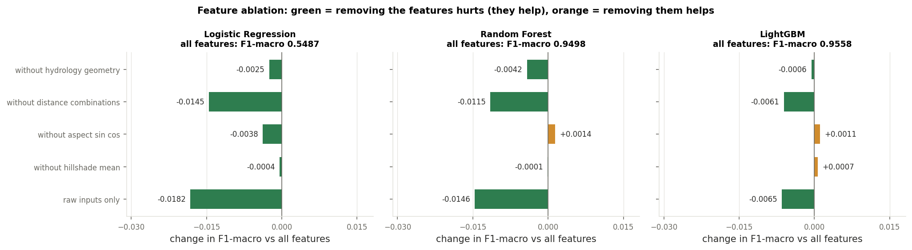

### Are the differences between models real?

The tree ensembles differ by a few thousandths of F1-macro, so `src/significance.py`
(menu option 13, `make significance`) checks the ranking on the same 116,203 test cells:
a 95 % bootstrap interval of F1-macro for every model (2,000 resamples), a **paired**
bootstrap of the difference between two models (both scored on the same resampled cells),
and McNemar's exact test on the cells where exactly one of the two models is right
(accuracy view), with Holm correction over the 10 pairs.

| Model | F1-macro | 95 % CI |
|---|---|---|
| **LightGBM, balanced weights** | **0.9558** | [0.9525, 0.9589] |
| HistGradientBoosting | 0.9546 | [0.9512, 0.9578] |
| LightGBM, no weights | 0.9537 | [0.9503, 0.9572] |
| Random Forest | 0.9498 | [0.9462, 0.9531] |
| Logistic Regression | 0.5487 | [0.5415, 0.5557] |

| Selected LightGBM vs | Δ F1-macro, paired 95 % CI | Cells only LightGBM right / only other right | McNemar, Holm p |
|---|---|---|---|
| Random Forest | +0.0060 [+0.0032, +0.0090] — significant | 1,177 / 1,003 | 4·10⁻⁴ |
| HistGradientBoosting | +0.0012 [−0.0009, +0.0034] — **not significant** | 1,116 / 665 | 4·10⁻²⁶ |
| LightGBM, no weights | +0.0021 [−0.0001, +0.0044] — **not significant** | 694 / 754 | 0.12 |

* LightGBM is significantly better than Random Forest on both F1-macro and accuracy.
* Against HistGradientBoosting the F1-macro difference is within noise, but LightGBM is
  right on 1.7× more of the disputed cells (significantly higher accuracy). Choosing
  LightGBM is therefore justified by accuracy, not by the 0.0012 F1-macro margin;
  HistGradientBoosting would be an equally valid choice if a smaller and 4× faster-predicting
  model mattered more (60 vs 91 MB, 101 vs 402 ms per 1k rows).
* Balanced class weights do not change LightGBM significantly on either metric: the
  imbalance experiment shows no measurable effect.
* Retrained here, Random Forest scores 0.9498 instead of 0.9489 in the main table (different
  CPU / thread count); LightGBM is the committed model and HistGradientBoosting reproduces
  exactly. Test-split predictions of every model: `reports/test_predictions.parquet`.

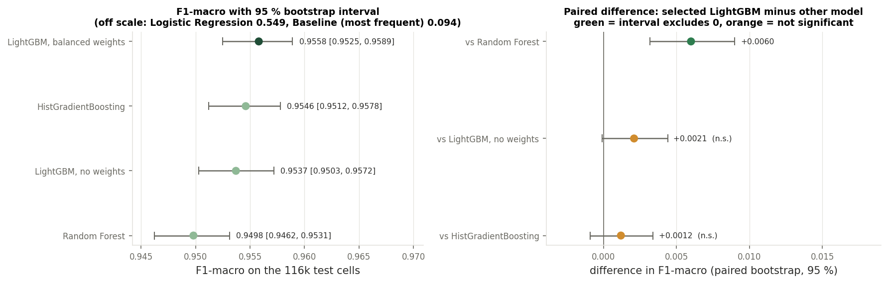

### Group validation: an unseen wilderness area

Neighbouring 30 m cells are spatially correlated and the data have no coordinates, so the
random split cannot tell how the model transfers to new terrain. The wilderness area is the
only available spatial group: `src/robustness.py` (menu option 10) trains on three areas and
tests on the fourth.

| Held-out area | LightGBM, random split | LightGBM, area held out | same, without area feature | Random Forest, held out | Baseline, held out |
|---|---|---|---|---|---|
| Rawah | 0.965 | 0.347 | 0.353 | 0.375 | 0.180 |
| Neota | 0.984 | 0.315 | 0.448 | 0.290 | 0.154 |
| Comanche Peak | 0.959 | 0.244 | 0.337 | 0.286 | 0.110 |
| Cache la Poudre | 0.956 | 0.253 | 0.271 | 0.265 | 0.038 |

(F1-macro; the random-split column is the selected model on that area's cells of the test split.)

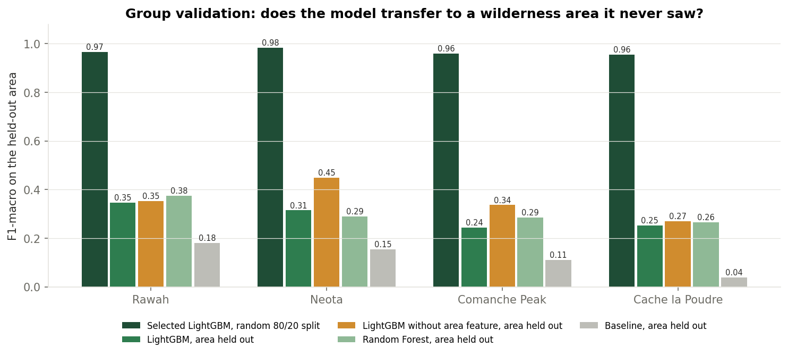

**Limitation, measured.** The 0.956 F1-macro holds for new cells inside the four mapped areas,
not for an unseen area (0.24–0.45). Dropping the area code recovers only part of the gap: the
relation between terrain, soil and species itself differs between areas, and
Cottonwood/Willow exists only in Cache la Poudre. Mapping a new area needs labelled cells
from it.

## Deliverables

* Report: [`docs/Report_Forest_Cover_Classification.pdf`](docs/Report_Forest_Cover_Classification.pdf) (DOCX source alongside)
* Presentation: [`docs/Presentation_Forest_Cover_Classification.pptx`](docs/Presentation_Forest_Cover_Classification.pptx) (+ PDF)
* Defense notebook: [`notebooks/Forest_Cover_Defense.ipynb`](notebooks/Forest_Cover_Defense.ipynb),
  [open in Colab](https://colab.research.google.com/github/mara-werils/forest-cover-classification/blob/main/notebooks/Forest_Cover_Defense.ipynb)

## Requirement checklist

| # | Requirement | Where |
|---|---|---|
| 1 | ≥ 5 functions besides `main` | every module; e.g. `data_loader.read_in_chunks`, `audit.iqr_outliers`, `features.split_data`, `models.tune`, `evaluate.error_analysis` |
| 2 | lists / dicts | lookup dicts in `config.py`, `QUERIES` dict, results as lists of dicts |
| 3 | if / elif / else | menu dispatch, input validation, `PeakMemory`, ER layout |
| 4 | loops | chunk loop, menu `while True`, model loop, re-ask loop in `ask_int` |
| 5 | files | CSV, Parquet, JSON, SQLite, joblib, PNG/HTML |
| 6 | try / except | download error, missing files, invalid user input, broken history JSON |
| 7 | UI | console menu (`main.py`) + Streamlit dashboard with filters (`app.py`) |
| 8 | modularity | 16 modules in `src/`; `os`, `pathlib`, `json`, `datetime`, `time`, `sqlite3`, `threading` |
| 9 | ≥ 2 approaches + baseline | Dummy vs LR vs RF vs HistGB vs LightGBM (quality incl. ROC/PR-AUC, time, memory, size); CSV vs Parquet; pandas vs SQL; random vs group split |
| 10 | SQLite, ER, ≥ 8 queries | `database.py`, `er_diagram.py`, 12 queries in `queries.py` loaded with `pd.read_sql_query` |
| 11 | ≥ 500k rows, memory | 581,012 rows; `chunksize=100_000`, int16/uint8 dtypes, Parquet |
| C7 | EDA, Pipeline/ColumnTransformer, split before fitting, CV tuning, metrics, importance, error analysis, joblib, UI prediction | `audit.py`, `eda.py`, `features.py`, `models.py`, `evaluate.py`, `predict.py` |

## Extensions beyond the mandatory tasks

* Group validation by wilderness area, with and without the area feature.
* ROC-AUC and PR-AUC for every model.
* Two gradient-boosting libraries (HistGradientBoosting, LightGBM) and a class-weight experiment.
* Learning curve (F1-macro vs training size) that justifies using all 581k rows.
* Test predictions stored in SQLite and analysed with SQL (Q10–Q12).
* Peak training memory measured with a psutil thread (sees LightGBM's C++ allocations).
* Console menu + Streamlit dashboard + Colab defense notebook; 157 tests and CI on
  Python 3.11–3.14; pinned versions.
* Class-conditional outlier audit, model-free feature relevance (MI, ε², Cramér's V) and
  covariate/label shift between areas (PSI, KS, TVD).
* Generated data dictionary with a test that fails when it drifts from the data.
* Feature ablation (raw vs engineered features, leave-one-group-out) for three model families.
* Statistical significance of the model ranking: bootstrap CIs, paired bootstrap, McNemar + Holm.
* A documented negative result: the diverged HistGB configuration (`reports/diverged_runs.json`).

## Reference

Blackard, J. A., & Dean, D. J. (1999). Comparative accuracies of artificial neural networks
and discriminant analysis in predicting forest cover types from cartographic variables.
*Computers and Electronics in Agriculture*, 24(3), 131–151.
