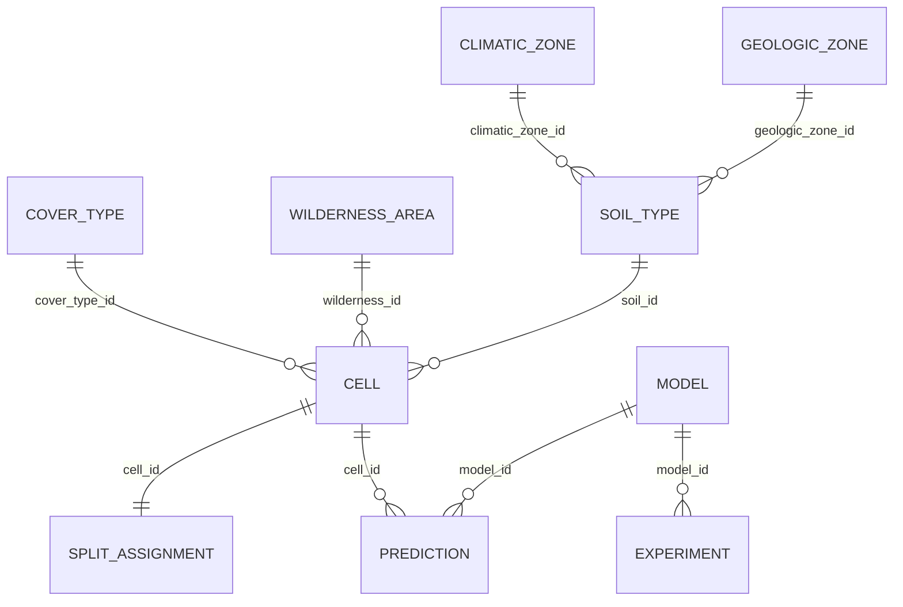

# Forest Cover Type Classification

Final project for **Programming for AI** (Applied Artificial Intelligence, MSc), topic 37,
cluster 7 "Machine Learning on Tabular Data".

**Goal:** predict which of 7 forest cover types grows on a 30 × 30 m cell of the Roosevelt
National Forest (Colorado) from cartographic and soil variables only, and compare a
baseline with Logistic Regression, Random Forest and Gradient Boosting on a multi-class,
strongly imbalanced problem (F1-macro, confusion matrix).

**Team**

| Member | Group | Main responsibility |
|---|---|---|
| Amanbaev Marlen | AAI-2601 | Data loading, Parquet & dtype optimisation, SQLite schema + SQL, console menu, Streamlit app |
| Erik [surname] | [group] | Data quality audit, EDA, visualisations |
| Rashad [surname] | [group] | Feature pipelines, model tuning & comparison, interpretation, error analysis |

The report and the presentation were written together; every member can explain every
module (see the report, section "Contributions").

---

## Data

* **Source:** UCI Machine Learning Repository, *Covertype* (Blackard & Dean, 1998),
  <https://archive.ics.uci.edu/dataset/31/covertype>, licence CC BY 4.0.
* 581,012 rows × 55 columns: 10 numeric features, 4 one-hot wilderness areas,
  40 one-hot soil types, target `Cover_Type` (1–7).
* The archive (11 MB zipped, 72 MB as CSV) is **downloaded automatically** by step 1 into
  `data/raw/`; it is not stored in the repository. A stratified 1,000-row sample is
  committed in `data/sample/` for the tests.

## Quick start

```bash
git clone https://github.com/mara-werils/forest-cover-classification.git
cd forest-cover-classification
python -m venv .venv && source .venv/bin/activate      # Windows: .venv\Scripts\activate
pip install -r requirements.txt

python main.py --all        # full pipeline, ~30–60 min on a laptop CPU
python main.py              # interactive console menu
streamlit run app.py        # dashboard with filters + prediction form
python -m pytest -q         # 6 fast tests on the committed sample
```

Developed and tested with Python 3.14 on macOS (Apple Silicon, 16 GB RAM); only CPU is
needed, any Python ≥ 3.10 with the listed packages should work. Works the same in
VS Code / PyCharm (run `main.py`) and in Google Colab
(`!git clone ...`, `%cd forest-cover-classification`, `!pip install -r requirements.txt`,
`!python main.py --all`).
Thread count defaults to 4 and can be changed with `FCT_THREADS=8 python main.py --all`.

### Console menu

```
 1 - Prepare data (download, chunked load, dtype optimisation, Parquet)
 2 - Data quality audit
 3 - Build SQLite database (normalised schema)
 4 - Exploratory analysis: save all figures
 5 - Train and compare models (baseline, LR, RF, HistGB, LightGBM)
 6 - Interpret best model (importance, error analysis, learning curve)
 7 - Run an SQL query
 8 - Predict cover type for your own values
 9 - Show experiment results
 0 - Exit
```

Steps must be run in order the first time (1 → 6). Every step reads its input from disk,
so after one full run any step can be repeated on its own. A missing input file or an
invalid value is caught (`try/except`) and reported without leaving the menu.

## Project structure

```
forest-cover-classification/
├── main.py               console menu, `--all` for the full pipeline
├── app.py                Streamlit dashboard (filters, EDA, SQL, models, prediction)
├── requirements.txt
├── src/
│   ├── config.py         paths, column names, lookup tables, seeds
│   ├── data_loader.py    download, chunked typed read, memory report, Parquet, CSV vs Parquet
│   ├── audit.py          missing values, duplicates, one-hot integrity, ranges, IQR outliers
│   ├── eda.py            all EDA figures (+ interactive Plotly scatter)
│   ├── database.py       SQLite schema, loading in chunks, experiment / prediction tables
│   ├── queries.py        12 analytical SQL queries, pandas vs SQL check
│   ├── er_diagram.py     ER diagram (PNG) + Mermaid source
│   ├── features.py       feature engineering + preprocessing pipelines, split
│   ├── models.py         model zoo, CV tuning, memory / size measurement, joblib
│   ├── evaluate.py       metrics, confusion matrices, permutation importance, error analysis
│   ├── pipeline.py       steps that glue the modules together
│   └── predict.py        validated single-record prediction + history (JSON)
├── tests/test_pipeline.py
├── data/sample/          1,000-row stratified sample (raw/ and processed/ are generated)
├── models/               best_model.json (best_model.joblib is generated)
├── reports/              JSON/CSV/Parquet results, sql/ query outputs, figures/
└── docs/                 report (PDF/DOCX), presentation, ER diagram source
```

## Database

Normalised SQLite schema (`data/processed/covtype.db`): the 44 one-hot columns are replaced
by foreign keys, soil types are linked to climatic and geologic zones decoded from their
USFS ELU code, and experiments/predictions are stored next to the data so that model errors
can be analysed with SQL.




12 queries in `src/queries.py` (results in `reports/sql/`): JOINs across up to 4 tables,
GROUP BY/HAVING, correlated and FROM-subqueries, CTEs, and the window functions
`SUM() OVER`, `ROW_NUMBER`, `RANK`, `NTILE`, `LAG`. Q10–Q12 analyse model errors.

## Data processing results

| | Default `read_csv` | Chunked + compact dtypes |
|---|---|---|
| DataFrame memory | 243.8 MB (all `int64`) | **33.8 MB** (−86.1%) |

| Format | File | Load time | Peak RAM |
|---|---|---|---|
| CSV, default dtypes | 71.7 MB | 0.80 s | 488 MB |
| CSV, compact dtypes | 71.7 MB | 0.69 s | 128 MB |
| **Parquet** | **6.9 MB** | **0.15 s** | 7 MB |
| Parquet, 3 columns | 6.9 MB | 0.007 s | 1 MB |

Audit: no missing values, no duplicates, no invalid one-hot rows, no out-of-range values.
IQR outliers (≤ 5.4% per column) are real terrain extremes and were kept
(`reports/data_audit.json`).

## Model results

Stratified 80/20 split (464,809 train / 116,203 test), all preprocessing inside
scikit-learn `Pipeline`s, hyper-parameters by `RandomizedSearchCV` (3-fold stratified CV,
F1-macro) on a 40k-row subsample, refit on the full train split.

| Model | Accuracy | **F1-macro** | Balanced acc. | Train, s | Predict, ms / 1k rows | Size, MB |
|---|---|---|---|---|---|---|
| Baseline (most frequent) | 0.488 | 0.094 | 0.143 | 1 | 0.4 | 0.00 |
| Logistic Regression | 0.731 | 0.548 | 0.525 | 43 | 1 | 0.01 |
| Random Forest | 0.972 | 0.949 | 0.939 | 62 | 10 | 568 |
| HistGradientBoosting | 0.970 | 0.955 | 0.961 | 328 | 101 | 60 |
| **LightGBM, balanced weights** | 0.974 | **0.956** | 0.959 | 172 | 402 | 91 |
| LightGBM, no weights | 0.974 | 0.954 | 0.947 | 182 | 312 | 89 |


* **LightGBM with balanced class weights** is the selected model (`models/best_model.joblib`,
  40 MB compressed): best F1-macro at a moderate size.
* Tree ensembles beat the linear model by 0.41 F1-macro: the rare classes are defined by
  interactions (elevation belt × area × soil). Logistic Regression does not improve with more
  data (learning curve), Random Forest and LightGBM improve up to the full 465k rows.
* 69% of the 3,063 test errors are Spruce/Fir ↔ Lodgepole Pine, two species of the same
  elevation belt. Cells with top probability < 0.6 (1.7%) have a 45% error rate, the rest 1.9%.
* Permutation importance: Elevation ≫ distance to roads ≈ distance to fire points >
  wilderness area > soil type.
* A tuned HistGradientBoosting configuration (lr = 0.2, balanced weights) diverged when
  refitted on all data (F1-macro 0.38, see `reports/diverged_runs.json`); the search space was
  restricted to lr ≤ 0.1.

| Confusion matrix (LightGBM) | Learning curve |
|---|---|
|  |  |

**Limitation.** Neighbouring 30 m cells are spatially correlated and the data have no
coordinates, so the random split gives an optimistic estimate for a completely new region.

## Deliverables

* Report: [`docs/Report_Forest_Cover_Classification.pdf`](docs/Report_Forest_Cover_Classification.pdf) (DOCX source alongside)
* Presentation: [`docs/Presentation_Forest_Cover_Classification.pptx`](docs/Presentation_Forest_Cover_Classification.pptx) (+ PDF)
* Defense notebook: [`notebooks/Forest_Cover_Defense.ipynb`](notebooks/Forest_Cover_Defense.ipynb),
  [open in Colab](https://colab.research.google.com/github/mara-werils/forest-cover-classification/blob/main/notebooks/Forest_Cover_Defense.ipynb)

## Requirement checklist

| # | Requirement | Where |
|---|---|---|
| 1 | ≥ 5 functions besides `main` | every module; e.g. `data_loader.read_in_chunks`, `audit.iqr_outliers`, `features.split_data`, `models.tune`, `evaluate.error_analysis` |
| 2 | lists / dicts | lookup dicts in `config.py`, `QUERIES` dict, results as lists of dicts |
| 3 | if / elif / else | menu dispatch, input validation, `PeakMemory`, ER layout |
| 4 | loops | chunk loop, menu `while True`, model loop, re-ask loop in `ask_int` |
| 5 | files | CSV, Parquet, JSON, SQLite, joblib, PNG/HTML |
| 6 | try / except | download error, missing files, invalid user input, broken history JSON |
| 7 | UI | console menu (`main.py`) + Streamlit dashboard with filters (`app.py`) |
| 8 | modularity | 12 modules in `src/`; `os`, `pathlib`, `json`, `datetime`, `time`, `sqlite3`, `threading` |
| 9 | ≥ 2 approaches + baseline | Dummy vs LR vs RF vs HistGB vs LightGBM (quality, time, memory, size); CSV vs Parquet; pandas vs SQL |
| 10 | SQLite, ER, ≥ 8 queries | `database.py`, `er_diagram.py`, 12 queries in `queries.py` loaded with `pd.read_sql_query` |
| 11 | ≥ 500k rows, memory | 581,012 rows; `chunksize=100_000`, int16/uint8 dtypes, Parquet |
| C7 | EDA, Pipeline/ColumnTransformer, split before fitting, CV tuning, metrics, importance, error analysis, joblib, UI prediction | `audit.py`, `eda.py`, `features.py`, `models.py`, `evaluate.py`, `predict.py` |

## Reference

Blackard, J. A., & Dean, D. J. (1999). Comparative accuracies of artificial neural networks
and discriminant analysis in predicting forest cover types from cartographic variables.
*Computers and Electronics in Agriculture*, 24(3), 131–151.
